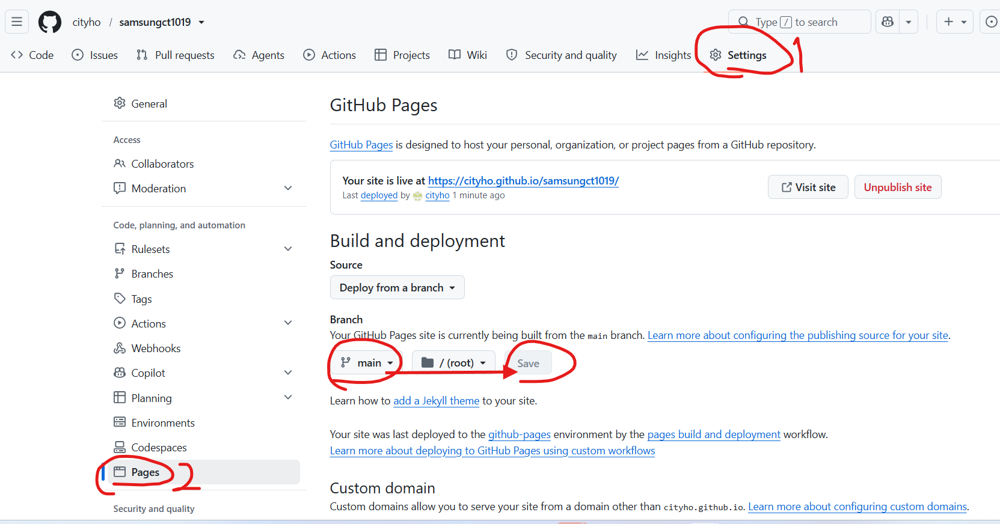
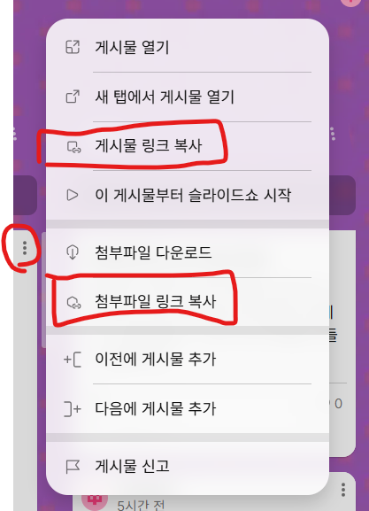
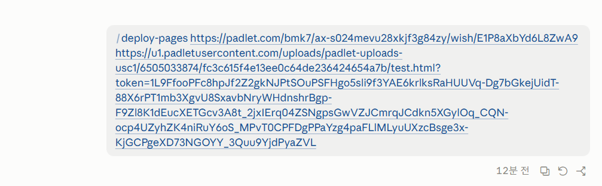

# samsungct1019

패들릿에 올라온 수강생의 HTML 첨부파일을 GitHub Pages로 배포하는 저장소입니다.

배포 주소 형식: `https://cityho.github.io/samsungct1019/<게시물제목>/`

각 폴더의 `index.html`이 해당 주소의 페이지가 됩니다.

## 기본 세팅 (GitHub Pages)

처음 한 번만 설정하면 됩니다.

1. 저장소의 **Settings** 탭으로 이동합니다.
2. 왼쪽 메뉴에서 **Pages**를 선택합니다.
3. **Build and deployment**의 Source를 `Deploy from a branch`로 두고, Branch를 `main` / `/ (root)`로 선택한 뒤 **Save**를 누릅니다.



## `/deploy-pages` 스킬 사용법

Claude Code에서 `/deploy-pages`를 실행하면 업로드부터 배포 확인까지 자동으로 진행합니다. "깃허브 페이지로 배포", "html 올려줘"라고 말해도 동작합니다.

### 준비물

| 항목 | 설명 |
| --- | --- |
| 첨부파일 직접 링크 | `https://u1.padletusercontent.com/.../파일.html?token=...` 형태. 패들릿 보드 주소로는 첨부를 읽을 수 없습니다. |
| 게시물 링크 | `https://padlet.com/.../wish/xxxx` 형태. 게시물 제목(폴더명)과 댓글 초안에 사용합니다. 없으면 제목을 직접 알려주면 됩니다. |

### 링크 복사하는 방법

패들릿 게시물 오른쪽 위의 점 세 개(⋮) 메뉴에서 복사합니다.

- **게시물 링크 복사**: 게시물 링크
- **첨부파일 링크 복사**: 첨부파일 직접 링크



### 호출하는 방법

입력창에 `/deploy-pages` 뒤에 **게시물 링크**와 **첨부파일 링크**를 공백으로 구분해 이어서 붙여넣고 보내면 됩니다.

```
/deploy-pages <게시물 링크> <첨부파일 링크>
```



### 진행 순서

1. **사전 점검**: git, gh 설치, 작성자 정보, GitHub 로그인 상태를 확인합니다.
2. **저장소 확인**: `samsungct1019` 폴더가 있으면 `git pull`만 하고, 없으면 최초 1회 클론합니다.
3. **게시물 제목 확인**: 폴더명으로 쓸 이름을 정하고, 사용할 수 없는 문자(`\ / : * ? " < > |`)는 제거합니다.
4. **다운로드**: 첨부파일을 `<제목>/index.html`로 저장하고 HTML이 맞는지 확인합니다. 받은 파일은 실행하지 않습니다.
5. **커밋 & 푸시**: 변경이 `<제목>` 폴더뿐인지 확인한 뒤 `upload file` 메시지로 푸시합니다.
6. **배포 확인**: Pages 빌드(1~2분)가 끝나 HTTP 200이 될 때까지 확인하고, 브라우저로 엽니다.
7. **댓글 초안 제공**: 패들릿 댓글은 로그인이 필요해 자동으로 달 수 없습니다. 제공된 초안을 게시물에 직접 붙여넣어 주세요.

### 댓글 초안 예시

```
접속 가능한 링크 전달드립니다!
https://cityho.github.io/samsungct1019/<제목>/
```

### 문제 해결

- **git/gh가 없을 때**: `winget install --id Git.Git -e`, `winget install --id GitHub.cli -e`로 설치한 뒤 새 터미널을 엽니다. 관리자 권한 창에서는 "예"를 눌러야 합니다.
- **GitHub 로그인이 안 되어 있을 때**: 터미널에서 직접 `gh auth login`을 실행합니다. 이후 푸시가 `could not read Username`으로 실패하면 `gh auth setup-git`을 실행합니다.
- **푸시가 403으로 거부될 때**: 저장소 쓰기 권한이 없는 것입니다. collaborator 초대를 수락하거나 권한을 요청합니다.
- **배포 주소가 계속 404일 때**: 저장소 Settings → Pages 설정을 확인합니다.
